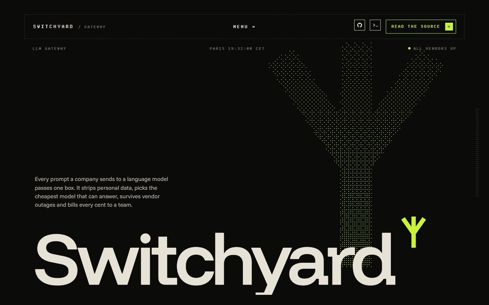
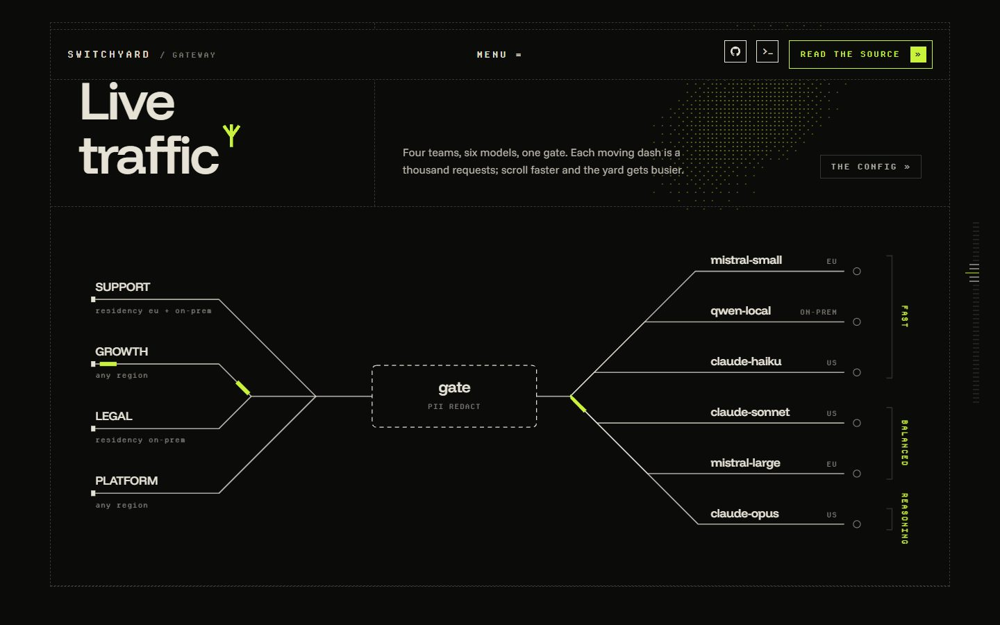
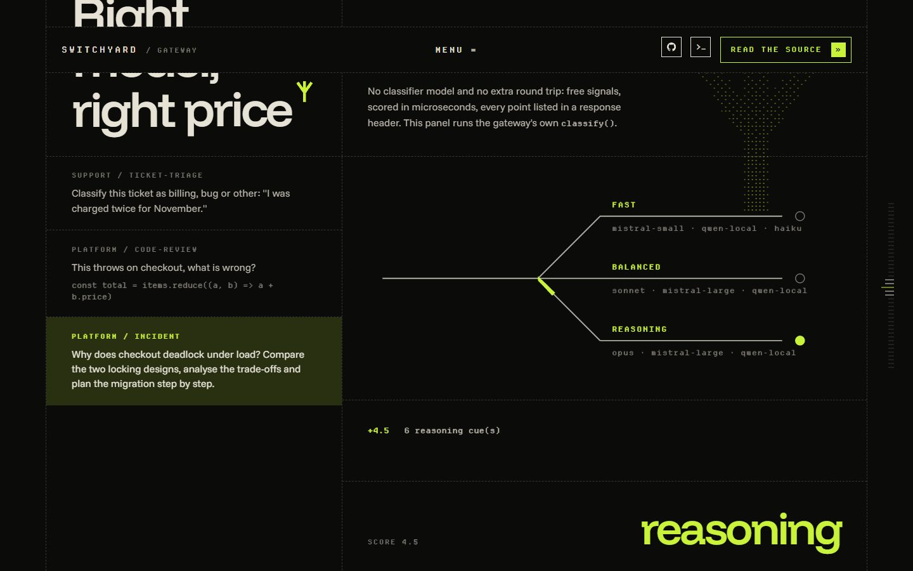
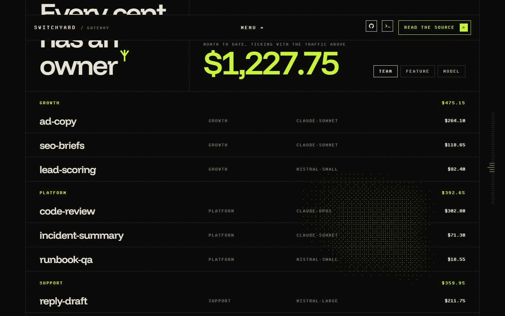
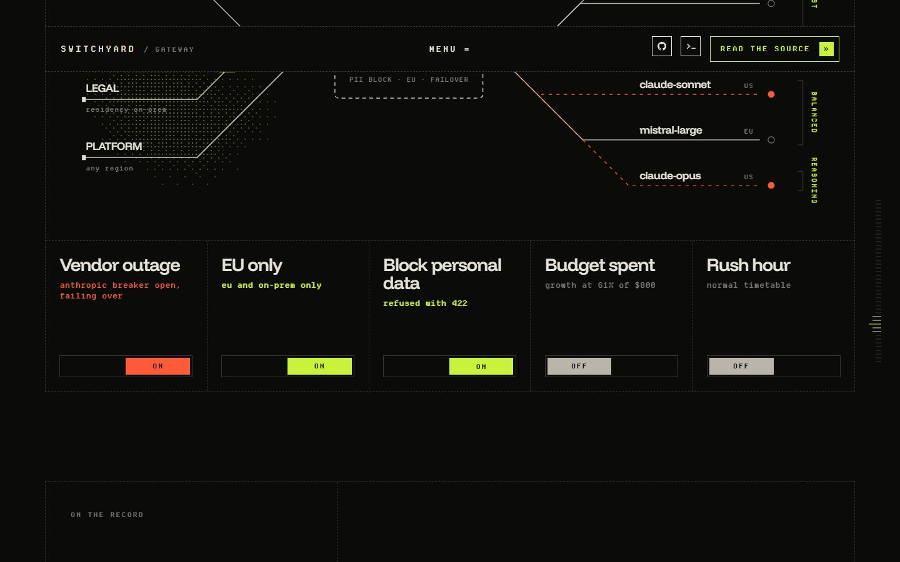

# Switchyard

A gateway for a company's LLM traffic. Teams keep their OpenAI SDK and
change one base URL; from then on every prompt passes the same box, where it is:

- **inspected**: emails, phones, IBANs, card and social security numbers are
  replaced by tokens before anything leaves, and put back in the answer;
- **routed** to the cheapest model that can do the job, with fallback to the
  next vendor when one is down;
- **accounted** for, to the micro-dollar, against a team and a feature, with
  a monthly budget enforced before the call.

[Showcase](https://toni-bobocel.github.io/switchyard/) ·
[Decisions](docs/adr) ·
[Gateway tests](apps/gateway/test/gateway.test.ts)





## Why it exists

Three conversations happen in every company that ships LLM features:

| Who        | Worry                                                      | Switchyard's answer                                                                          |
| ---------- | ---------------------------------------------------------- | -------------------------------------------------------------------------------------------- |
| DPO / CISO | Customer data sent to a US vendor                          | Redaction before routing, per-team residency (`eu`, `on-prem`), or a hard `422`              |
| CFO        | An AI bill nobody can explain                              | One ledger row per request, grouped by team, feature, model or tier; `402` at the budget     |
| CTO        | One vendor's outage or price change takes the product down | One OpenAI-shaped API in front of all of them, ordered fallback, per-vendor circuit breakers |

## Use it

```sh
cp .env.example .env               # vendor keys
pnpm install && pnpm build
pnpm --filter @switchyard/gateway keygen   # issue a team key, paste the hash in the config
SWITCHYARD_CONFIG=switchyard.example.json pnpm --filter @switchyard/gateway start
```

```sh
curl localhost:8080/v1/chat/completions \
  -H "authorization: Bearer sy_demo_support" \
  -H "x-switchyard-feature: ticket-triage" \
  -d '{"model":"auto","messages":[{"role":"user","content":"Classify: I was charged twice"}]}'
```

`model` is `auto`, a tier (`fast`, `balanced`, `reasoning`) or a model name
from the config. Every answer says what happened:

```
x-switchyard-tier: fast
x-switchyard-model: mistral-small
x-switchyard-route: score -2; -2 triage task
x-switchyard-redactions: 0
x-switchyard-fallbacks: 0
x-switchyard-cost-micros: 24
```

Spend, for the calling team, or for everyone with an admin key:

```sh
curl "localhost:8080/v1/usage?group_by=feature" -H "authorization: Bearer sy_demo_platform"
```

With Docker: `docker compose up --build` starts the gateway and an Ollama
container for the on-prem tier.

## How a request flows

1. **Key → team.** Keys are compared by SHA-256 in constant time; the config
   holds hashes only and can live in a repo.
2. **Budget.** Month-to-date spend from the ledger. Over the limit: `402`.
3. **Redaction.** `@switchyard/pii` finds values, checksums the structured
   ones (Luhn, IBAN mod 97, NIR key) and swaps each for a stable token. Policy
   per team: `redact`, `block`, `off`.
4. **Routing.** `classify()` scores the prompt from free signals (length,
   reasoning cues, triage cues, code, depth) into a tier. Candidates are the
   tier's models filtered by the team's residency. See
   [ADR 3](docs/adr/0003-heuristic-routing.md) for why this is not an LLM.
5. **Dispatch.** First candidate whose breaker is closed. `429`/`5xx`/timeouts
   move to the next; a `400` is returned as is. Streams can only fall back
   before the first byte.
6. **Restore and record.** Tokens are put back, including tokens split across
   SSE chunks. One ledger row is written in integer micro-dollars.



## Trade-offs I took on purpose

- **Regex and checksums, not NER.** Fast, deterministic, and free of false
  positives on order numbers. Names and free-text addresses are not caught;
  that needs a model and belongs in a separate service behind the same
  `Vault` interface.
- **Heuristic routing.** Zero latency and explainable; it will misroute some
  requests. The ledger records tier and model per feature, which is the data
  needed to tune it or to justify a learned router in shadow mode.
- **SQLite ledger.** One node, no dependency. Several replicas need Postgres
  (same schema) or a queue into the warehouse. See
  [ADR 4](docs/adr/0004-ledger-on-sqlite.md).
- **Budgets can overshoot** by the requests in flight. Reserving an estimate
  per request fixes it at the cost of a write per call.
- **Text only.** Tools, vision and prompt caching differ per vendor; each
  needs an explicit answer for what happens on fallback before it is exposed.





## Layout

```
apps/
  gateway/    hono service, vendor adapters, routing, ledger, tests
  site/       showcase (GitHub Pages); its routing panel imports classify()
packages/
  pii/        detectors, checksums, vault, streaming restorer
docs/adr/     architecture decision records
```

The example prices in `switchyard.example.json` are illustrative. Check each
vendor's current pricing before trusting a budget.

## License

MIT
